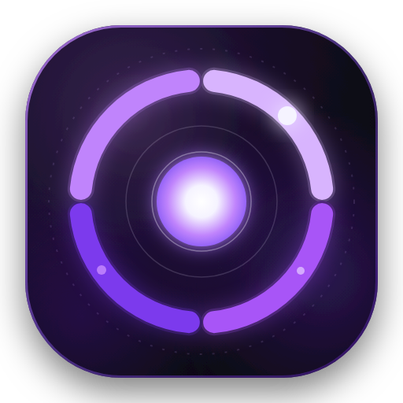
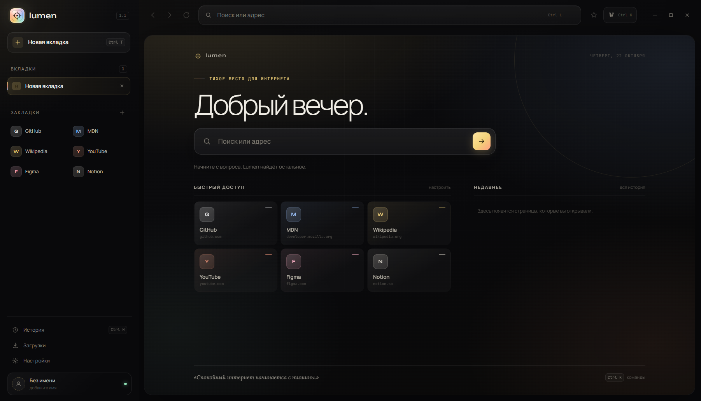
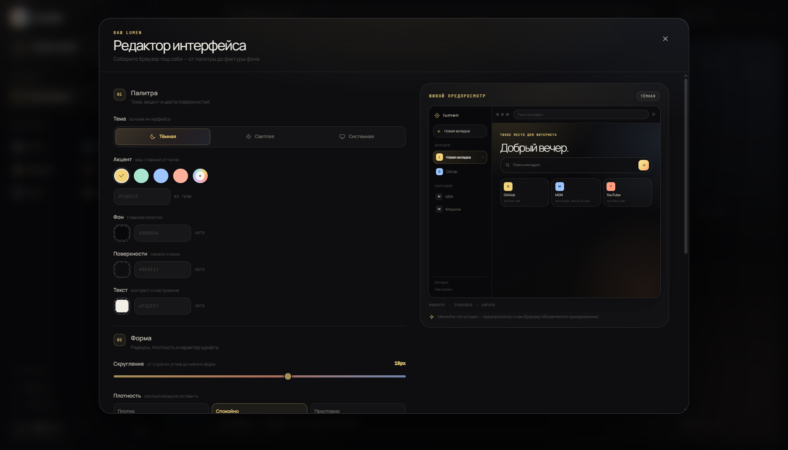
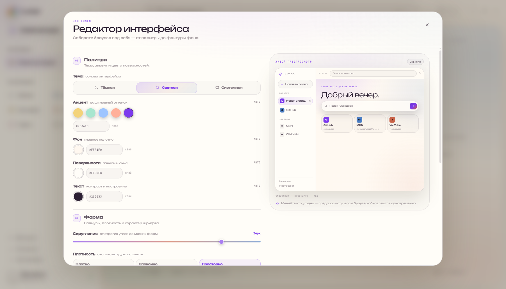
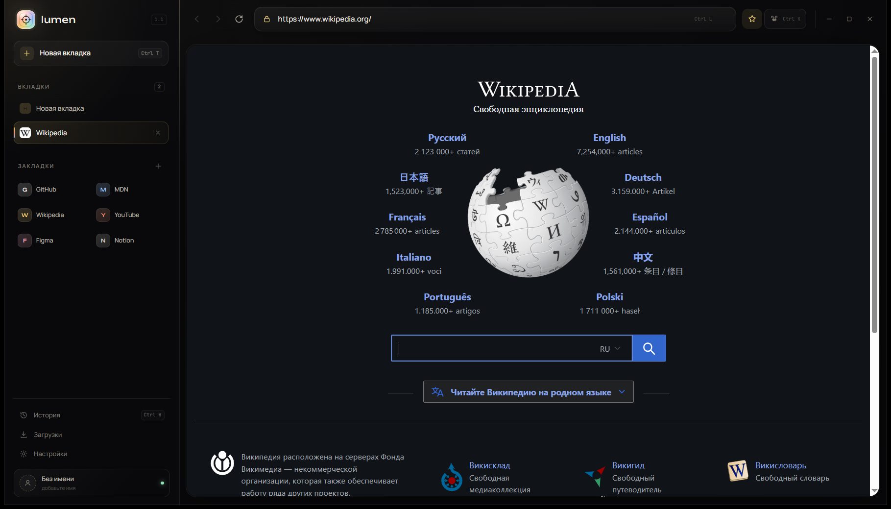

<div align="center">



# Lumen

**Тихое место для интернета.**

Спокойный браузер на Chromium с собственным интерфейсом, тёплой типографикой
и редактором, который позволяет собрать Lumen под себя.

<br>


<br><br>

<a href="https://github.com/LumenDev33/lumenBrowser/releases/latest">
  
</a>

</div>

<br>



## Почему Lumen

| | |
| --- | --- |
| **Настоящий браузер** | Не имитация интерфейса: каждая вкладка — отдельный `WebContentsView` на Chromium. Сайты, видео, формы и авторизация работают по-настоящему. |
| **Меньше шума** | Нет панели закладок на пол-экрана, всплывающих новостей и навязчивых подсказок. Только вкладки, адресная строка и тихая стартовая страница. |
| **Свой характер** | Многоцветная палитра, тёплая типографика, мягкие тени и аккуратная анимация. Lumen не выглядит как ещё одна копия Chrome. |
| **Полный контроль** | Редактор интерфейса меняет не только акцент: цвет фона, поверхностей и текста, радиусы, плотность, шрифт и фактуру стартовой страницы. |

## Что внутри

- **Вкладки на Chromium.** Настоящая навигация, история переходов, масштаб, контекстное меню и DevTools.
- **Новая вкладка как тихое пространство.** Поиск, быстрый доступ к закладкам и недавняя история без визуального шума.
- **Закладки.** Звезда в адресной строке, карточки на стартовой странице и блок в боковой панели.
- **История.** Поиск, группировка по дням, удаление отдельных записей и полная очистка.
- **Загрузки.** Прогресс, размер, открытие файла и показ в системной папке.
- **Command palette.** `Ctrl K` — команды, поиск по истории и закладкам в одном месте.
- **Сессия.** Lumen запоминает открытые вкладки и восстанавливает их после перезапуска.
- **Ссылки и новые окна.** `target="_blank"` и `window.open` открываются как вкладки; `mailto:` и `tel:` передаются системе.
- **Личное приветствие.** Если имя не задано, Lumen здоровается без обращения. Имя можно изменить или очистить в настройках.
- **Поисковики.** Chrome, Яндекс и DuckDuckGo — на выбор.

## Редактор интерфейса

Не просто выбор темы, а полноценная мастерская внешнего вида. Откройте
**Настройки → Интерфейс → Открыть редактор** или нажмите `Ctrl K` и выберите
«Редактор интерфейса».

<div align="center">
  
</div>

| Раздел | Что можно настроить |
| --- | --- |
| **Палитра** | Тёмная, светлая или системная тема. Любой акцент, фон, цвет поверхностей и текста через цветовое колесо или HEX-код. |
| **Форма** | Радиус от строгих `0 px` до мягких `30 px`, плотность интерфейса и один из четырёх шрифтов: Manrope, Unbounded, Lora или JetBrains Mono. |
| **Атмосфера** | Пять фактур стартовой страницы: «Аврора», «Меш», «Сетка», «Точки» и «Чистый». Плюс свечение, закладки в панели и анимации. |

Всё меняется **сразу**: и в живом макете редактора, и в самом браузере.
Настройки сохраняются автоматически, а кнопка **«Сбросить вид»** возвращает
Lumen к исходному облику.

<div align="center">
  
  <br>
  <sub>Один и тот же Lumen после нескольких минут в редакторе.</sub>
</div>

## Скриншоты



## Скачать

Готовая portable-версия для Windows лежит в
[GitHub Releases](https://github.com/LumenDev33/lumenBrowser/releases/latest).

```text
Lumen-1.2.0-portable.exe
```

Это один `.exe`, которому не нужна установка. Запустите его — и браузер готов.
Данные хранятся локально в профиле приложения.

## Запуск из исходников

```bash
npm install
npm start
```

Или напрямую через Electron:

```bash
npx electron .
```

Требуется **Node.js 22.12+**. Приложение использует **Electron 45**, чистый
JavaScript и CSS — без React, TypeScript и сборщика.

## Сборка `.exe`

```bash
npm install
npm run dist
```

Готовый файл появится здесь:

```text
dist/Lumen-1.2.0-portable.exe
```

Для отладочной сборки без упаковки в один файл:

```bash
npm run dist:dir
```

## Две версии

| Ветка | Для чего |
| --- | --- |
| **`main`** | Основная версия: полный проект, оформленный README, ассеты и релиз с `.exe`. |
| **`test`** | Тестовая версия: только исходный код и минимальные файлы для запуска. Без релизных артефактов и скриншотов. |

## Горячие клавиши

| Сочетание | Действие |
| --- | --- |
| `Ctrl T` | Новая вкладка |
| `Ctrl W` | Закрыть вкладку |
| `Ctrl Shift T` | Вернуть закрытую вкладку |
| `Ctrl Tab` / `Ctrl Shift Tab` | Переключение вкладок |
| `Ctrl L` | Фокус в адресную строку |
| `Ctrl K` | Command palette |
| `Ctrl H` | История |
| `Ctrl D` | Добавить или убрать закладку |
| `Ctrl ,` | Настройки |
| `Ctrl R` / `F5` | Обновить страницу |
| `Alt ←` / `Alt →` | Назад / вперёд |
| `Ctrl +` / `Ctrl -` / `Ctrl 0` | Масштаб |
| `F12` | DevTools страницы |

## Структура

```text
lumen-browser/
├─ src/
│  ├─ main.js            # окно, вкладки, WebContentsView, IPC, состояние
│  ├─ preload.js         # безопасный window.lumen
│  └─ ui/
│     ├─ index.html      # разметка, SVG-иконки, редактор
│     ├─ styles.css      # дизайн-система и темы
│     └─ app.js          # интерфейс, настройки, предпросмотр
├─ assets/
│  ├─ icon.svg
│  └─ icon.png
├─ preview.png
├─ preview-page.png
├─ designer-preview.png
├─ designer-custom.png
├─ package.json
└─ README.md
```

## Данные и приватность

Состояние хранится локально:

```text
<app.getPath("userData")>/lumen-state.json
```

Внутри — настройки, закладки, история, загрузки и последняя сессия.
Загруженные файлы сохраняются в системную папку «Загрузки».

Запросы разрешений сайтов (геолокация, уведомления, камера) по умолчанию
отклоняются — это осознанное решение для спокойного и безопасного браузера.

## Примечания

- Движок страниц — Chromium из состава Electron. Обновление Electron обновляет и Chromium.
- Интерфейс адаптирован под минимальное окно **1024 × 680**.
- `src/ui/index.html` умеет открываться в обычном Chrome в демо-режиме — с тестовыми вкладками и данными, без Electron.
- Lumen не собирает телеметрию и не отправляет данные наружу.

---

<div align="center">
  <sub>Сделано как маленький, личный браузер: без лишних панелей и без спешки.</sub>
</div>
