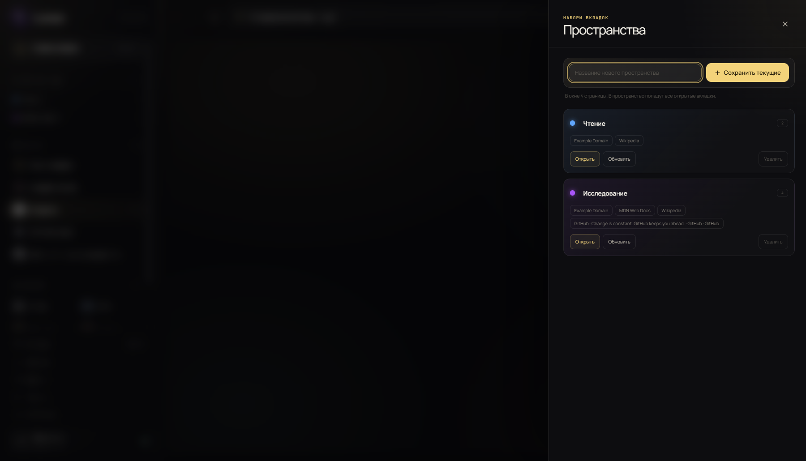
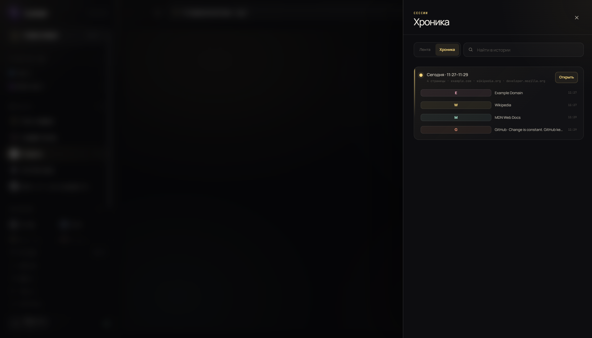
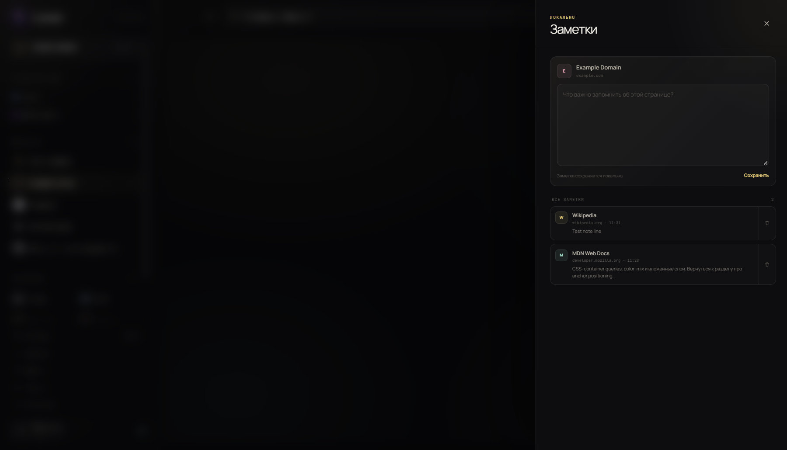
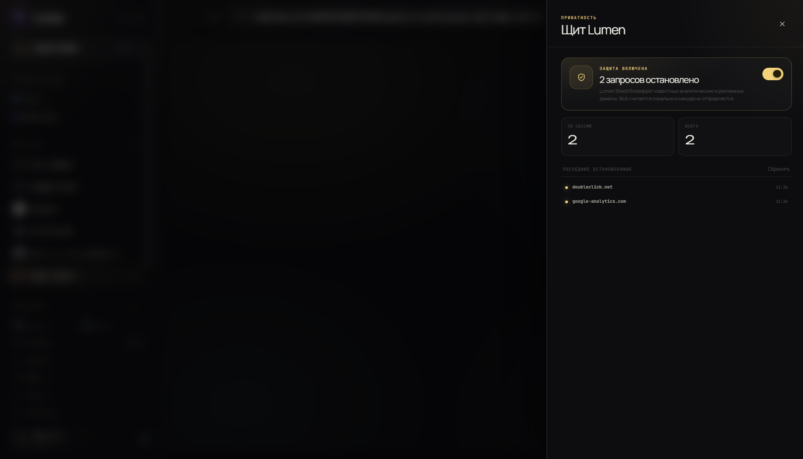
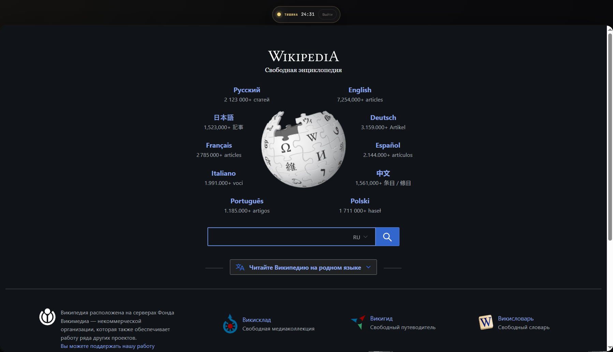
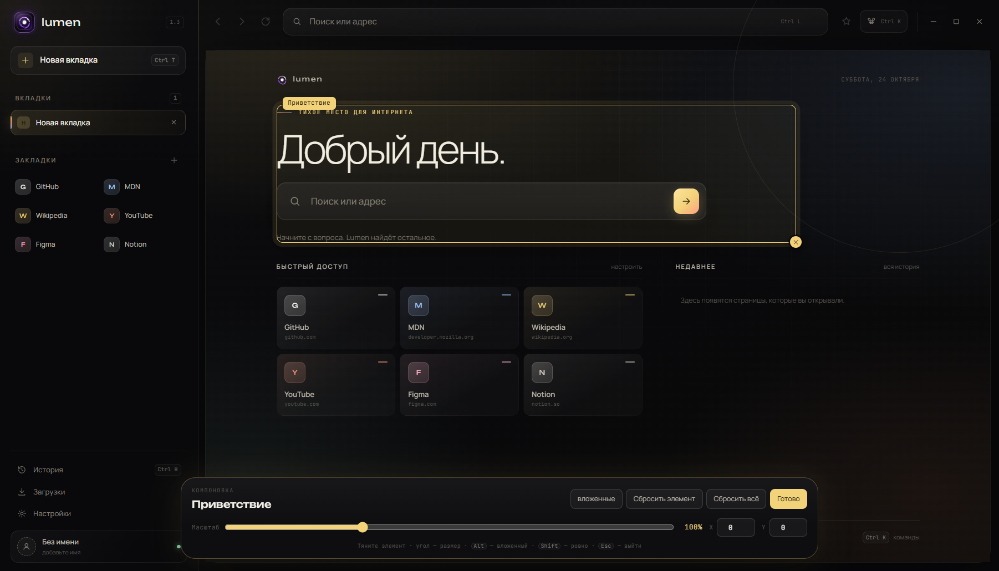
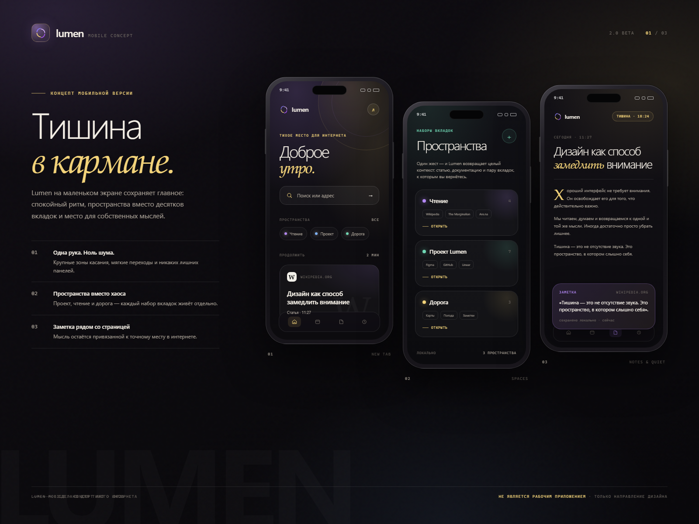

<div align="center">


# Lumen

**Тихое место для интернета.**

Спокойный браузер на Chromium с собственным интерфейсом, тёплой типографикой
и редактором, который позволяет собрать Lumen под себя.

**2.0 Beta** добавляет пространства, хронику сессий, заметки к страницам,
локальный щит приватности и режим «Тишина».

<br>


<br><br>

<a href="https://github.com/LumenDev33/lumenBrowser/releases">
  
</a>

</div>

<br>


## Почему Lumen

| | |
| --- | --- |
| **Настоящий браузер** | Не имитация интерфейса: каждая вкладка — отдельный `WebContentsView` на Chromium. Сайты, видео, формы и авторизация работают по-настоящему. |
| **Меньше шума** | Нет панели закладок на пол-экрана, всплывающих новостей и навязчивых подсказок. Только вкладки, адресная строка и тихая стартовая страница. |
| **Свой характер** | Многоцветная палитра, тёплая типографика, мягкие тени и аккуратная анимация. Lumen не выглядит как ещё одна копия Chrome. |
| **Полный контроль** | Редактор интерфейса меняет не только акцент: цвет фона, поверхностей и текста, радиусы, плотность, шрифт и фактуру стартовой страницы. А режим компоновки позволяет перетаскивать и масштабировать любые элементы интерфейса. |

## Что внутри

- **Вкладки на Chromium.** Настоящая навигация, история переходов, масштаб, контекстное меню и DevTools.
- **Новая вкладка как тихое пространство.** Поиск, быстрый доступ к закладкам и недавняя история без визуального шума.
- **Закладки.** Звезда в адресной строке, карточки на стартовой странице и блок в боковой панели.
- **История.** Поиск, группировка по дням, удаление отдельных записей и полная очистка.
- **Загрузки.** Прогресс, размер, открытие файла и показ в системной папке.
- **Пространства.** Именованные наборы вкладок для проекта, чтения или дороги. Открываются одним нажатием и не дублируют уже открытые страницы.
- **Хроника сессий.** История собирается в смысловые сессии с паузами в 30 минут; сессию можно открыть целиком.
- **Заметки.** Локальные заметки к точному `http(s)`-адресу с автосохранением и быстрым возвратом к странице.
- **Щит Lumen.** Локальная блокировка подресурсов известных аналитических и рекламных доменов без счётчиков и облака.
- **Тишина.** 25 минут только страницы: боковая панель и панель инструментов скрываются, сверху остаётся маленький таймер.
- **Свободная компоновка.** Перетаскивайте панели, кнопки и блоки, меняйте их масштаб и сохраняйте раскладку автоматически.
- **Command palette.** `Ctrl K` — команды, поиск по истории, закладкам и заметкам в одном месте.
- **Сессия.** Lumen запоминает открытые вкладки и восстанавливает их после перезапуска.
- **Ссылки и новые окна.** `target="_blank"` и `window.open` открываются как вкладки; `mailto:` и `tel:` передаются системе.
- **Личное приветствие.** Если имя не задано, Lumen здоровается без обращения. Имя можно изменить или очистить в настройках.
- **Поисковики.** Chrome, Яндекс и DuckDuckGo — на выбор.

## Что нового в 2.0

| Функция | Что делает |
| --- | --- |
| **Пространства** | Сохраняет открытые вкладки как именованный набор. Пространство открывается одним нажатием и не дублирует страницы, которые уже открыты. |
| **Хроника сессий** | Собирает историю в смысловые сессии по 30-минутным паузам. Можно вернуться к целой сессии, а не открывать страницы по одной. |
| **Заметки** | Локальные заметки к точному URL страницы. Автосохранение, поиск по всем заметкам и быстрый переход обратно к источнику. |
| **Щит Lumen** | Локально блокирует запросы к известным аналитическим и рекламным доменам. Основной документ страницы не блокируется. |
| **Тишина** | Таймер на 25 минут скрывает боковую панель и панель инструментов, оставляя только страницу и маленький индикатор. |

<div align="center">
  
  <br>
  <sub>Пространства: наборы вкладок для проектов, чтения и всего, к чему хочется вернуться.</sub>
</div>

### Хроника сессий

История в Lumen теперь умеет собираться в **сессии**. Если между переходами
прошло больше 30 минут, начинается новая сессия. Внутри сессии видно время,
домены и страницы, а кнопка **«Открыть»** возвращает всю сессию во вкладки.

<div align="center">
  
  <br>
  <sub>Хроника: один взгляд на то, чем был занят день.</sub>
</div>

### Заметки к страницам

Заметка привязана к точному `http(s)`-адресу и хранится только в локальном
профиле. Текст сохраняется автоматически через полсекунды после ввода или по
кнопке **«Сохранить»**. Заметки можно открыть из боковой панели или через
`Ctrl K` → «Заметки».

<div align="center">
  
  <br>
  <sub>Заметки: маленький слой памяти поверх интернета.</sub>
</div>

### Щит Lumen

Щит работает на уровне сессии Chromium и отменяет только подресурсы
аналитики, рекламы и трекинга. Список намеренно консервативный: он не
заменяет полноценный блокировщик и не трогает основной документ страницы.
Счётчик и последние остановленные запросы видны в панели щита, статистику
можно сбросить.

<div align="center">
  
  <br>
  <sub>Щит Lumen: всё считается локально.</sub>
</div>

### Тишина

**Тишина** — это 25 минут без боковой панели и панели инструментов. Страница
остаётся на месте, а сверху висит маленькая капсула с таймером и кнопкой
выхода. Хорошо работает вместе с пространством «Чтение».

<div align="center">
  
  <br>
  <sub>Тишина: только страница, таймер и вы.</sub>
</div>

## Редактор интерфейса

Не просто выбор темы, а полноценная мастерская внешнего вида. Откройте
**Настройки → Интерфейс → Открыть редактор** или нажмите `Ctrl K` и выберите
«Редактор интерфейса».

<div align="center">
  
</div>

| Раздел | Что можно настроить |
| --- | --- |
| **Палитра** | Тёмная, светлая или системная тема. Любой акцент, фон, цвет поверхностей и текста через цветовое колесо или HEX-код. |
| **Форма** | Радиус от строгих `0 px` до мягких `30 px`, плотность интерфейса и один из четырёх шрифтов: Manrope, Unbounded, Lora или JetBrains Mono. |
| **Атмосфера** | Пять фактур стартовой страницы: «Аврора», «Меш», «Сетка», «Точки» и «Чистый». Плюс свечение, закладки в панели и анимации. |
| **Компоновка** | Свободное перемещение и масштаб: тяните элементы мышью, меняйте размер за угол и сохраняйте раскладку автоматически. |

Всё меняется **сразу**: и в живом макете редактора, и в самом браузере.
Настройки сохраняются автоматически, а кнопка **«Сбросить вид»** возвращает
Lumen к исходному облику.

### Режим компоновки

Откройте **Редактор интерфейса → Компоновка → Открыть компоновку** или
выберите «Компоновка интерфейса» в `Ctrl K`. В этом режиме страница временно
скрывается, а интерфейс становится редактируемым:

- тяните элемент мышью, чтобы переместить его;
- тяните круглый маркер в правом нижнем углу, чтобы уменьшить или увеличить элемент;
- `Alt` или кнопка **«вложенные»** выбирает внутренний элемент вместо целого блока;
- `Shift` при перемещении выравнивает по сетке 10 px;
- стрелки двигают выбранный элемент, `Delete` сбрасывает его;
- `Esc` или **«Готово»** выходит из режима.

Раскладка хранится в `settings.appearance.layout` и восстанавливается после
перезапуска. Кнопка **«Сбросить всё»** очищает все перемещения и масштабы.

<div align="center">
  
  <br>
  <sub>Режим компоновки: выберите элемент и тяните его или угол выделения.</sub>
</div>

<div align="center">
  
  <br>
  <sub>Один и тот же Lumen после нескольких минут в редакторе.</sub>
</div>

## Скриншоты


## Скачать

Готовая portable-версия для Windows лежит в
[GitHub Releases](https://github.com/LumenDev33/lumenBrowser/releases).

```text
Lumen-2.0.0-beta-portable.exe
```

Это один `.exe`, которому не нужна установка. Запустите его — и браузер готов.
Данные хранятся локально в профиле приложения. Версия `2.0.0 Beta` помечена на
GitHub как prerelease.

## Запуск из исходников

```bash
npm install
npm start
```

Или напрямую через Electron:

```bash
npx electron .
```

Требуется **Node.js 22.12+**. Приложение использует **Electron 45**, чистый
JavaScript и CSS — без React, TypeScript и сборщика.

## Сборка `.exe`

```bash
npm install
npm run dist
```

Готовый файл появится здесь:

```text
dist/Lumen-2.0.0-beta-portable.exe
```

Для отладочной сборки без упаковки в один файл:

```bash
npm run dist:dir
```

## Мобильный концепт

В 2.0 Beta есть концепт-арт мобильного Lumen — не отдельное приложение и не
рабочая сборка, а визуальное направление для будущей версии. В нём сохранены
главные идеи: тишина, пространства, заметки и мягкая типографика.

<div align="center">
  
  <br>
  <sub>Концепт-арт: Lumen на маленьком экране. Это изображение, а не функциональное приложение.</sub>
</div>

Исходник арт-борда лежит в [`concept/mobile-concept.html`](concept/mobile-concept.html).

## Две версии

| Ветка | Для чего |
| --- | --- |
| **`main`** | Основная версия: полный проект, оформленный README, ассеты и релиз с `.exe`. |
| **`test`** | Тестовая версия: только исходный код и минимальные файлы для запуска. Без релизных артефактов и скриншотов. |

## Горячие клавиши

| Сочетание | Действие |
| --- | --- |
| `Ctrl T` | Новая вкладка |
| `Ctrl W` | Закрыть вкладку |
| `Ctrl Shift T` | Вернуть закрытую вкладку |
| `Ctrl Tab` / `Ctrl Shift Tab` | Переключение вкладок |
| `Ctrl L` | Фокус в адресную строку |
| `Ctrl K` | Command palette |
| `Ctrl H` | История |
| `Ctrl D` | Добавить или убрать закладку |
| `Ctrl ,` | Настройки |
| `Ctrl R` / `F5` | Обновить страницу |
| `Alt ←` / `Alt →` | Назад / вперёд |
| `Ctrl +` / `Ctrl -` / `Ctrl 0` | Масштаб |
| `F12` | DevTools страницы |
| `Esc` в компоновке | Выйти из режима компоновки |
| `Alt` в компоновке | Выбрать вложенный элемент |

## Структура

```text
lumen-browser/
├─ src/
│  ├─ main.js            # окно, вкладки, WebContentsView, IPC, состояние, щит
│  ├─ preload.js         # безопасный window.lumen
│  └─ ui/
│     ├─ index.html      # разметка, SVG-иконки, редактор, новые панели
│     ├─ styles.css      # дизайн-система, темы, хроника, заметки, тишина
│     └─ app.js          # интерфейс, пространства, история, настройки, компоновка
├─ concept/
│  └─ mobile-concept.html # исходник арт-борда мобильного концепта
├─ assets/
│  ├─ icon.svg
│  └─ icon.png
├─ preview.png
├─ preview-page.png
├─ spaces-preview.png
├─ timeline-preview.png
├─ notes-preview.png
├─ shield-preview.png
├─ quiet-preview.png
├─ mobile-concept.png
├─ designer-preview.png
├─ designer-custom.png
├─ layout-preview.png
├─ package.json
└─ README.md
```

## Данные и приватность

Состояние хранится локально:

```text
<app.getPath("userData")>/lumen-state.json
```

Внутри — настройки, закладки, история, загрузки, пространства, заметки,
статистика щита и последняя сессия. Загруженные файлы сохраняются в системную
папку «Загрузки».

Пространства и заметки не синхронизируются и не покидают профиль. Заметки
доступны только для `http(s)`-страниц. Щит работает локально: он не отправляет
списки доменов и счётчики на сервер. Запросы разрешений сайтов (геолокация,
уведомления, камера) по умолчанию отклоняются — это осознанное решение для
спокойного и безопасного браузера.

## Примечания

- Движок страниц — Chromium из состава Electron. Обновление Electron обновляет и Chromium.
- Интерфейс адаптирован под минимальное окно **1024 × 680**.
- `src/ui/index.html` умеет открываться в обычном Chrome в демо-режиме — с тестовыми вкладками и данными, без Electron.
- Lumen не собирает телеметрию и не отправляет данные наружу.
- `2.0.0 Beta` — prerelease: новые функции уже работают, но могут меняться до стабильной версии.
- Мобильный концепт — статичный арт-борд, а не отдельное приложение или сборка.
- Щит Lumen намеренно консервативен и не заменяет полноценный блокировщик рекламы.

---

<div align="center">
  <sub>Сделано как маленький, личный браузер: без лишних панелей и без спешки.</sub>
</div>
